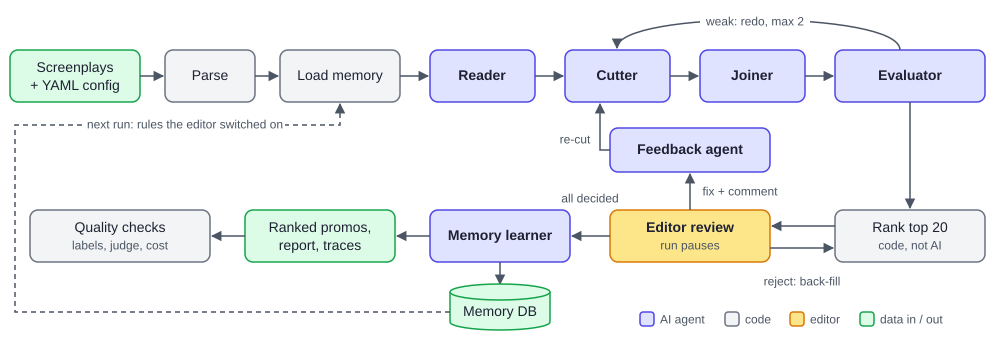

# Promo Finder

Reads the screenplays of a microdrama and finds the best **20–60 second promo clips**. Each promo
**opens on a hook**, **ends on a cliffhanger** and **makes sense on its own**. For every promo it gives the
episode, exact start and end timestamps for every segment, the hook, the cliffhanger and one line on
why it works, ranked best first. An editor can approve, reject or fix the picks, and the tool learns
from those decisions.

Kuku AI Generalist assignment, Problem 1. The full write-up is in [explain.md](explain.md), and the
detailed diagrams are in [docs/graph.md](docs/graph.md).

> **Confidential input.** The screenplays are not in this repo. `input/`, `output/`, `logs/`,
> `checkpoints/` and the memory database are git-ignored. The app serves on `localhost` only.

---

## How it works

An agentic system in which **each agent has one job**, with its own prompt and its own model, both set in
config. AI proposes and judges, code checks every answer and does the ranking, and an editor decides.



1. **Reader** reads the show episode by episode, carrying a running story summary, and marks hooks and
   cliffhangers.
2. **Cutter** turns one episode's moments into 20–60 s promos.
3. **Joiner** builds promos from clips in different episodes.
4. **Evaluator** sees only the promo, like a viewer scrolling past, and scores the hook, the cliffhanger and
   whether it stands alone. Weak promos go back to their maker with a fix, at most twice.
5. **Code ranks** the promos (score, earliness, no duplicates, at most 2 per episode), picks the top 20 and the
   run **pauses for the editor**.
6. **Feedback agent** turns the editor's comments into exact re-cuts; rejected slots are back-filled with the
   next-best promo.
7. **Memory learner** saves the decisions and suggests rules. A rule is used in later runs only after the
   editor switches it on.

**Code, not AI, checks every answer:** timestamps must be real line boundaries, lengths 20–60 s, the hook in
the first 3 s and the cliffhanger in the last 10 s. Bad answers are retried, and a backup model takes over
when a free quota runs out. The flow is a fixed LangGraph graph, checkpointed after every step, so a crash,
quota stop or review pause resumes where it stopped.

**Why one job per agent:** each prompt stays small, each answer can be checked, and a cheap model can read
while a stronger one judges.

---

## 1. Setup (about 5 minutes)

Developed and tested on Python 3.14.

```bash
python -m venv .venv
# Windows:      .venv\Scripts\activate
# macOS/Linux:  source .venv/bin/activate
pip install -r requirements.txt
```

**API keys.** Both have free tiers and no card is needed. Copy `.env.example` to `.env` and fill in:

| Key | Where to get it | Used by |
|---|---|---|
| `GOOGLE_API_KEY` | https://aistudio.google.com/apikey | Reader, Cutter, Joiner (Gemini); AI labeller (Gemma) |
| `GROQ_API_KEY` | https://console.groq.com/keys | Evaluator (gpt-oss) and backup models |

Check the keys and models work (one tiny call per agent):

```bash
python -m llm.smoke --input "<screenplays folder>" --episode 1 --agents reader evaluator
```

**Input.** Put the screenplays in a folder, one `.txt` file per episode, e.g. `input/My Show/`.
The format the parser expects is defined in [config/parser.yaml](config/parser.yaml).

---

## 2. Run it

### Command line

```bash
# Free dry run: fake agents, no API calls (checks the whole pipeline in seconds)
python run.py --input "input/My Show" --show "My Show" --genre "romance drama" --agents stub --no-review

# Real run on a few episodes first
python run.py --input "input/My Show" --show "My Show" --genre "romance drama" --episodes 1-5 --no-review

# Full show, pausing for editor review after ranking (review in this terminal)
python run.py --input "input/My Show" --show "My Show" --genre "romance drama" --review
```

| Flag | What it does |
|---|---|
| `--episodes 1-5,8` | only these episodes (cheap trial runs) |
| `--no-review` | skip the editor review pause |
| `--review` | review in the terminal when the run pauses (approve / reject / fix + comment) |
| `--no-memory` | don't read or write the editor's learned rules |
| `--no-joiner` | single-episode promos only |
| `--model reader=groq:openai/gpt-oss-120b` | swap one agent's main model (repeatable); its backups stay behind it |
| `--resume <run_id>` | continue a run that stopped (quota, crash, Ctrl+C) or paused for review |
| `--decisions <file.json>` | resume a paused run with review decisions from a file |

Exit codes: `0` done · `2` waiting for review · `3` stopped, resume to continue · `4` already running · `1` error.

**Swapping models.** Every agent's model and its backups are in `models:` in
[config/settings.yaml](config/settings.yaml). `groq` and `google_genai` are set up. Another LangChain
chat provider (e.g. OpenAI or Anthropic) needs one entry under `providers:` with its key's env var, plus its
`langchain-<provider>` package. No code changes are needed. When a free quota runs out, the run switches
to the next backup. If no backup is left, it stops safely and `--resume` continues later.

### Web app

```bash
streamlit run app/streamlit_app.py      # http://localhost:8501
```

- **New run:** upload the screenplays, choose the options and models, then start. The run keeps going if the
  page is closed.
- **Runs:** live progress, ranked promos (cards or table), the full trace of every promo, and editor review
  (approve / reject / fix, before vs after).
- **Evaluation:** quality reports (see section 4).
- **Memory:** the rules learned from reviews. Each one waits for the editor to switch it on.

---

## 3. Outputs

Each run writes to `output/runs/<run_id>/`:

| File | Contents |
|---|---|
| `promos.json` / `promos.csv` | the ranked promos: rank, segments (episode, start, end), duration, hook, cliffhanger, why it works, scores |
| `report.md` | readable report of the ranked list |
| `raw/` | every Reader moment, every promo made (including dropped ones and why), ranking report, review log |
| `traces/<promo_id>.json` | full history of one promo: moments used, every version, every score, editor decisions |
| `run_summary.json` | counts, switches, models actually used, token usage, errors |

AI calls are logged to `logs/llm/<run_id>/`. Progress is checkpointed to `checkpoints/` after every step.

---

## 4. Check quality

```bash
# 1. Label good moments yourself, BLIND (before looking at the tool's picks)
python -m evaluate.labels --input "input/My Show" --show "My Show" --episodes 2-6

# 2. Where did the tool find or lose them? (recall funnel: Reader -> promo made -> final list)
python -m evaluate.compare --run <run_id>

# 3. Would you post each pick? If not, why? (post rate + failure categories)
python -m evaluate.judge --run <run_id>

# 4. Cost per show and per week, from the run's real token counts
python -m evaluate.cost --run <run_id> --shows-per-week 10 --episodes-per-show 50

# 5. All runs side by side, and approval with vs without memory
python -m evaluate.runs
```

AI labeller and test shows with known answers (details in [explain.md](explain.md), Phase 4):

```bash
python -m evaluate.ai_labels --input "input/My Show" --show "My Show" --genre "romance drama" --episodes 2-9
python -m evaluate.agreement --reference output/eval/labels/<show>.yaml --candidate output/eval/labels/<show>-ai.yaml
python -m evaluate.synthetic_show --show "The Glass Heir" --genre "romance drama" --episodes 8 --seed 7
```

Reports go to `output/eval/`.

---

## 5. Tests

```bash
pytest            # about 200 tests, about 1 minute, no network (fake models)
```

---

## Project layout

| Folder | What's inside |
|---|---|
| `run.py` | command-line entry point |
| `parser/` | screenplay text → episodes, scenes and lines with exact timestamps |
| `agents/` + `prompts/` | Reader, Cutter, Joiner, Evaluator, feedback agents and their prompts (YAML) |
| `llm/` | one client for all AI calls: structured output, fact checks, retries, backup models, logging |
| `graph/` | the LangGraph pipeline, checkpoints, exports ([docs/graph.md](docs/graph.md)) |
| `docs/` | diagrams: `orchestration.svg` (above), `graph.md` (generated pipeline graph + end-to-end view) |
| `ranking/` | scoring, de-duplication and limits for the final list |
| `memory/` | editor feedback and learned rules (SQLite) |
| `evaluate/` | labels, recall funnel, post rate, cost, AI labeller, agreement, test shows |
| `app/` | Streamlit app |
| `config/` | every setting, rule and model choice (YAML, checked at startup) |
| `tests/` | automated tests (made-up screenplays only) |
