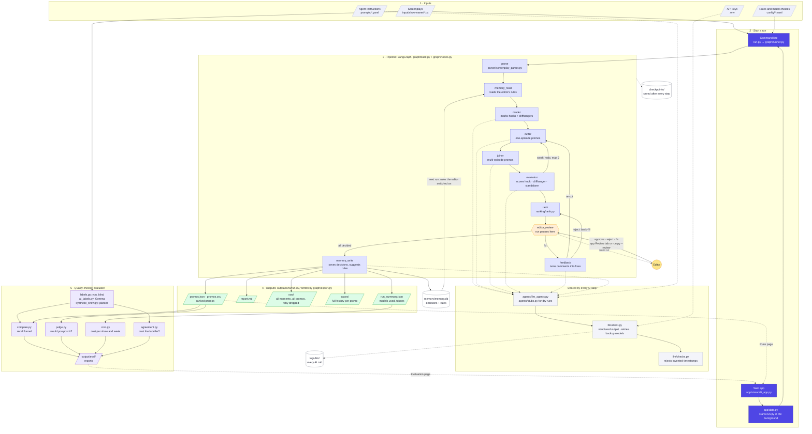
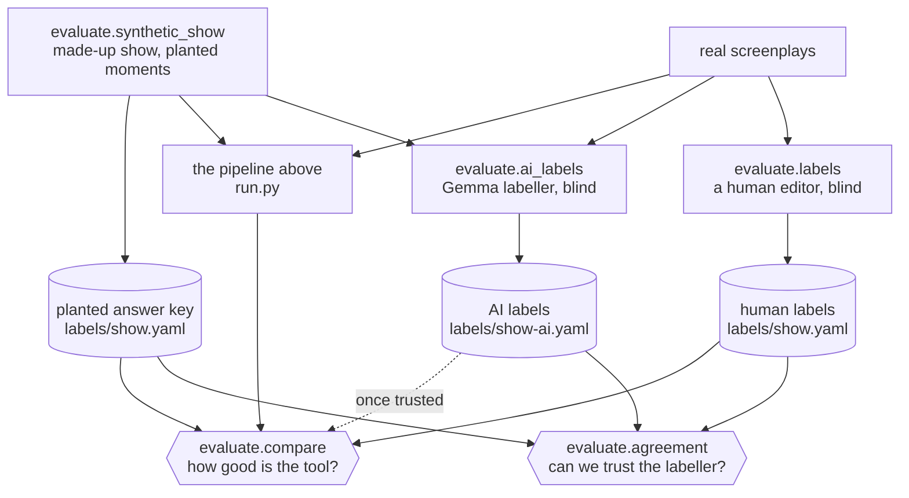

<!-- Hand-written notes for docs/graph.md, built by `python -m graph.diagram`.
     Edit this file, not graph.md. The pipeline graph is generated from graph/build.py and
     inserted where the PIPELINE_GRAPH marker is. -->

## End-to-end orchestration

The whole system on one page: what goes in, which file does each step, what comes out, and
the two loops. The editor's decisions improve the next run, and the quality checks measure
every run.

**Follow one run:**

1. **Start it.** From the command line (`run.py`) or the web app. The app starts the same `run.py`
   in the background, so a run survives a closed browser. Settings, models and rules come from
   `config/*.yaml`, and the API keys from `.env`.
2. **Parse.** The parser turns every screenplay file into lines with exact start and end times. Only
   these real times can be used later.
3. **Load memory.** The rules the editor switched on, plus a few approved and rejected examples, are
   added to the agents' instructions.
4. **Find, cut and join.** The Reader marks hooks and cliffhangers, one episode at a time. The Cutter
   turns them into one-episode promos, and the Joiner builds promos across episodes. Every AI call goes
   through `llm/client.py`, which demands structured answers, rejects invented timestamps, retries,
   and switches to a backup model when a free quota runs out. Each call is logged.
5. **Score.** The Evaluator sees only what a viewer would see and scores the hook, the cliffhanger and
   whether it stands alone. A weak promo goes back to its maker, at most twice.
6. **Rank.** Code, not AI, scores the promos, removes overlapping ones, applies limits and picks the
   final list.
7. **Editor review.** The run pauses and the editor approves, rejects or asks for a fix. A fix is
   re-cut and re-scored, then shown before and after. Every step is checkpointed, so a pause or crash
   loses nothing.
8. **Remember and write out.** Decisions go into the memory database, and suggested rules wait for the
   editor to switch them on for the next run. All results are written to `output/runs/<run_id>/`.
9. **Check quality.** Afterwards, `evaluate/` compares the picks with labels made blind (by you, by the
   AI labeller, or planted in a made-up show), asks whether you'd post each one, and works out the
   cost. The web app shows the results.

## Pipeline steps

The graph below is generated from [graph/build.py](../graph/build.py), so it always matches the code.

**How to read it:** a solid arrow always runs. A dotted arrow is a choice made in
[graph/routing.py](../graph/routing.py) from the current state. An arrow back to the same box
means "go round again" (the next episode, or the next batch).

<!-- PIPELINE_GRAPH -->

## What each step does

| Step | What it does | Where it goes next |
|---|---|---|
| `parse` | Reads the screenplay files into lines with exact timestamps | always `memory_read` |
| `memory_read` | Loads the editor's switched-on rules and examples (skipped with `--no-memory`) | always `reader` |
| `reader` | Marks hooks and cliffhangers, **one episode per pass**, keeping a story summary | itself until every episode is read, then `cutter` |
| `cutter` | Turns one episode's moments into single-episode promos, one episode per pass | itself until every episode is done; then `joiner` (if it is on, or it has fixes queued) or `evaluator` |
| `joiner` | Stitches clips from different episodes into multi-part promos (skipped with `--no-joiner`) | always `evaluator` |
| `evaluator` | Scores promos 1–10 for hook, cliffhanger and standalone, **batch by batch** | itself while promos are waiting; a weak promo goes back to `cutter` or `joiner` with a fix; otherwise `rank` |
| `rank` | Scores, removes duplicates, applies limits, picks the final list | `editor_review` (if review is on) or `memory_write` |
| `editor_review` | **Pauses** for the editor: approve, reject, fix + comment, keep before | `feedback` with decisions; `memory_write` when review is complete |
| `feedback` | Turns editor comments into precise fixes with real timestamps | `cutter` or `joiner` to remake a promo; otherwise `rank` again to back-fill rejected slots |
| `memory_write` | Saves the decisions and suggests new rules for the editor to switch on | the end |

## The loops, and why they always end

| Loop | Path | Limit |
|---|---|---|
| Per episode | `reader → reader`, `cutter → cutter` | one pass per episode |
| Per batch | `evaluator → evaluator` | until no promo is waiting |
| Revision | `evaluator → cutter/joiner → evaluator` | at most 2 redos per promo; then the best version is kept |
| Editor review | `rank → editor_review → feedback → … → rank` | at most 5 review rounds and 2 fixes per promo |

Progress is saved after every step (SQLite in `checkpoints/`), so `python run.py --resume <run_id>`
continues from the last finished step after a quota stop, a crash or the editor pause.

## Evaluation flow (outside the graph)

The evaluation commands in [evaluate/](../evaluate/) are **not part of the pipeline**. They run
before or after it and never change what it picks. The made-up show gives an exact answer key,
which grades both the tool and the AI labeller.

| Check | Compares | Result on 2026-11-07 |
|---|---|---|
| Tool vs planted key | run `glass-heir-e1` vs `the-glass-heir.yaml` | 11/13 marked by the Reader, 11/13 made, 8/13 ranked |
| Labeller vs planted key | `the-glass-heir-ai.yaml` vs `the-glass-heir.yaml` | recall 92%, precision 86%: "trust it" |
| Labeller vs a human | needs the editor to label 3–5 real episodes | not done yet |
